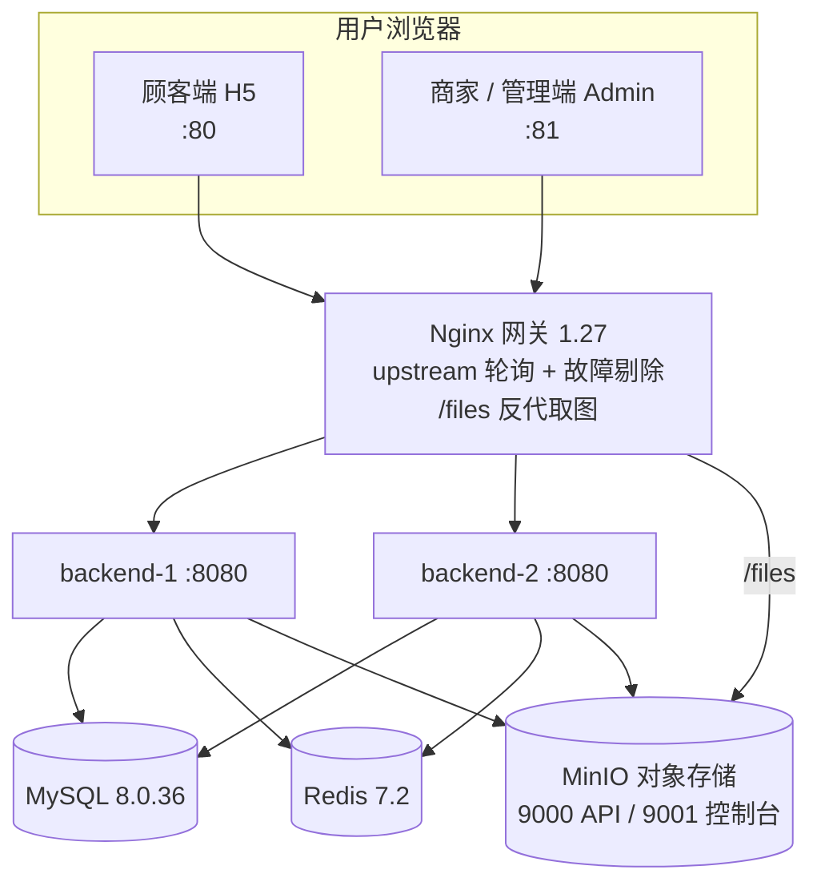

# 外卖系统 · Takeout System

> 一个「顾客端 / 商家端 / 管理后台」三端一体的外卖平台。
> 后端 Spring Boot 3 单体、内部按业务分包实现模块化；前端两套 Vue 3 工程；
> 配套 Docker Compose 单机全栈编排 + Ansible 自动化部署 + Zabbix 监控 + 双份数据库备份。

---

## 一、项目简介

三端共用一套后端与一个登录入口，通过账号 `userType` 与请求路径前缀做端级隔离：

| 端 | 使用者 | 前端工程 | 技术栈 | 端口 |
| --- | --- | --- | --- | --- |
| 顾客端 | 点外卖的人 | `frontend-h5` | Vue 3 + Vant（移动 H5） | 80 |
| 商家端 | 开店的老板 | `frontend-admin` | Vue 3 + Element Plus | 81 |
| 管理后台 | 平台运营 | 同 `frontend-admin`（登录后按身份注入菜单） | Vue 3 + Element Plus + ECharts | 81 |

后端是 **一个 Spring Boot 单体**，但内部按业务切成了 **12 个互不越界的模块**——
不是按「层」铺开，而是先按「业务」切开，每个业务内部再分层。这样将来任一模块要拆成微服务，
只需把模块间的 `XxxApi` 本地调用换成 HTTP 调用，业务代码零改动。

---

## 二、功能清单

**顾客端**
- 注册 / 登录 / 个人资料 / 修改密码
- 浏览店铺列表与店铺详情、按分类查看菜单
- 购物车（按店铺分组、实时计算价格、库存可用性提示）
- 收货地址管理（默认地址维护）
- 下单（后端重算金额、校验起送价）、订单列表 / 详情（状态时间轴）、取消订单、确认收货
- 模拟支付

**商家端**
- 店铺入驻申请 / 资料维护 / 营业状态切换（营业 / 休息）
- 菜品分类管理
- 菜品管理（增删改、上下架、库存）
- 订单处理：接单 / 拒单 / 取消 / 配送 / 完成
- 经营看板：总览、订单趋势、热销菜品

**管理后台**
- 店铺审核（通过 / 驳回）、强制打烊
- 账号管理（列表、停用/启用、重置密码）
- 全平台订单查询
- 平台看板：总览、商家排行

**通用能力**
- 图片上传（本地磁盘 / MinIO 对象存储，两种实现可切换）
- 接口文档（Swagger UI）
- 幂等防重复提交、接口限流、登录失败锁定

---

## 三、技术栈

| 层次 | 技术 | 版本 |
| --- | --- | --- |
| 语言 / 运行时 | Java | 17 |
| 后端框架 | Spring Boot | 3.2.5 |
| 持久层 | MyBatis-Plus + MySQL | 3.5.5 / 8.0.36 |
| 认证 | JJWT（双 token）+ BCrypt | 0.12.5 |
| 对象转换 | MapStruct + Lombok | 1.5.5.Final |
| 接口文档 | springdoc-openapi | 2.5.0 |
| 对象存储 | MinIO Java SDK | 8.5.7 |
| 缓存 | 本地内存 / Redis（接口抽象，可切换） | 7.2 |
| 前端框架 | Vue 3 + Vite + Pinia + Vue Router | 3.5.13 / 5.4.11 |
| 顾客端 UI | Vant | 4.9.15 |
| 商家 / 管理端 UI | Element Plus + ECharts | 2.8.8 / 5.5.1 |
| 网关 | Nginx（upstream 负载均衡） | 1.27-alpine |
| 容器编排 | Docker Compose | — |
| 自动化部署 | Ansible + Jinja2 模板 | — |
| 监控 / 备份 | Zabbix Agent2、rclone、mysqldump | — |

---

## 四、系统架构

### 4.1 部署拓扑（单机 Docker Compose）

**对外只暴露 80（顾客端 H5）与 81（商家 / 管理端 Admin）**
其余端口只在 Docker 网络内部或宿主机 `127.0.0.1` 上。



两个后端是同一镜像的两个实例，**不共享 JVM 内存**，所以必须外置共享：

| 状态 | 单机多实例的坑 | 解决方式 |
| --- | --- | --- |
| JWT 黑名单 / refresh token / 限流计数 | A 实例登出，B 实例还认这个 token | `CACHE_TYPE=redis` |
| 商品图片 / 用户头像 | 上传到 A 实例，B 实例读不到 | `FILE_STORAGE_TYPE=minio` |
| 业务数据 | —— | MySQL 天然共享 |

两种切换都通过接口抽象（`CacheClient` / `FileStorageService`）完成，**业务代码零改动**。

### 4.2 后端分层与依赖红线

```
三端前端
   ↓ HTTP
controller  →  service  →  mapper  →  数据库
                ↓
        其他模块的 xxx-api（只有接口和 DTO/VO）
                ↓
             common（公共地基）
```

三条不可破的规则：

1. `common` 不依赖任何业务模块，所有业务模块都可用 `common`。
2. 业务模块之间**只能**通过对方的 `xxx-api` 包通信，禁止直接查别人的表。
3. 每个模块只能改自己的表。

---

## 五、目录结构

```
外卖系统/
├── README.md                       # 本文件
├── .env.example                    # 本地开发环境变量模板（复制为 .env）
├── .gitignore
├── backend/                        # 后端（Spring Boot 单体，模块化分包）
│   ├── Dockerfile                  # 多阶段：Maven 编译 → JRE 运行
│   ├── pom.xml
│   └── src/main/
│       ├── java/com/takeout/
│       │   ├── common/             # 地基：返回体 / 异常 / 双 token / 缓存 / 注解切面
│       │   ├── auth/  user/        # 认证 / 账号
│       │   ├── merchant/  category/  dish/  cart/  address/
│       │   ├── order/  payment/  stats/  file/
│       │   └── TakeoutApplication.java
│       └── resources/
│           ├── application.yml
│           ├── mapper/             # MyBatis XML
│           └── sql/                # schema.sql + data.sql（幂等，启动自动执行）
├── frontend-h5/                    # 顾客端（Vue 3 + Vant）
├── frontend-admin/                 # 商家端 + 管理后台（Vue 3 + Element Plus）
├── deploy/                         # 部署编排
│   ├── docker-compose.yml          # 单机全栈：双后端 + Nginx + MinIO + MySQL + Redis
│   ├── .env.example
│   ├── nginx/                      # 网关镜像（多阶段构建前端）+ nginx.conf
│   └── ansible/                    # Ansible 自动化部署（site.yml + roles/）
└── docs/                           # 项目文档
    ├── 接口文档.md                  # 全量接口 + 错误码 + 数据结构
    ├── 部署文档.md                  # 部署架构与步骤
    ├── 部署验收清单.md              # 部署后逐项自检
    ├── 代码导读/                    # 12 篇模块级代码导读（作者视角）
    └── 验收文档.md
```

---

## 六、后端模块设计

### 6.1 十二个模块

| 包名 | 中文 | 一句话职责 | 拥有表 |
| --- | --- | --- | --- |
| `common` | 公共能力 | 统一返回体、异常处理、双 token 工具、缓存、注解与切面 | 无 |
| `auth` | 认证 | 三端登录、签发 / 刷新 / 登出令牌 | 无（只读写缓存） |
| `user` | 账号 | 三端共用一张账号表：注册、资料、改密、管理员管账号 | `sys_user` |
| `merchant` | 店铺 | 商家入驻、审核、营业状态、起送价与配送费 | `merchant` |
| `category` | 分类 | 菜品分类，顾客端菜单按它分组 | `category` |
| `dish` | 菜品 | 菜品增删改上下架，以及原子扣库存 SQL | `dish` |
| `cart` | 购物车 | 按店铺分组暂存想买的菜，价格实时算不快照 | `cart_item` |
| `address` | 收货地址 | 地址增删改 + 默认地址维护 | `address` |
| `order` | 订单 | 状态机、事务、扣库存、快照 | `orders` `order_item` `order_status_log` |
| `payment` | 支付 | 模拟支付，与订单状态联动 | `payment` |
| `stats` | 统计 | 只做聚合编排，不拥有任何表 | 无 |
| `file` | 文件 | 图片上传，返回可访问 URL（本地 / MinIO 双实现） | 无 |

### 6.2 模块内部「八件套」

每个业务模块内部结构一致，认识一套就认识全部：

| 子包 | 放什么 | 能否被其他模块引用 |
| --- | --- | --- |
| `api/` | 对外接口 + 契约 VO | ✅ 唯一入口 |
| `api/impl/` | 接口实现 | ❌ |
| `controller/` | HTTP 入口（收参数、校验、转交 service） | ❌ |
| `service/` `service/impl/` | 业务逻辑 + 事务 | ❌ |
| `mapper/` | 数据库访问（只写 SQL） | ❌ |
| `entity/` | 对应数据库表的类（不返回给前端） | ❌ |
| `dto/` | 接收前端参数 | ❌ |
| `vo/` | 返回前端的数据 | ❌ |
| `convert/` | entity ↔ vo 互转（MapStruct） | ❌ |

> 一句话：`entity` 绝不返回前端；进来的叫 `dto`，出去的叫 `vo`。

---

## 七、核心设计要点

**1. JWT 双 token（access + refresh）**
- access token：30 分钟，claims 带 `userType`；refresh token：7 天，按 `jti` 支持多端共存。
- 刷新即旋转：刷新时旧 refresh token 立即作废。登出时把 access token 拉黑（黑名单 TTL = 剩余有效期）。
- 三端统一入口 `POST /api/auth/login`，通过 `clientType` 校验端类型。
- 业务码在**响应体**里：access 过期返回 `code=40101`（HTTP 401），前端据此静默续期并重放原请求。

**2. 无锁防超卖**
- 扣库存用一条原子 SQL：`UPDATE dish SET stock = stock - #{qty} WHERE id = #{id} AND stock >= #{qty}`，
  受影响行数 = 0 即库存不足，直接抛业务异常、整单回滚。
- 销量只在订单**完成**时累加，不占用下单链路。

**3. 订单状态机 + 乐观锁**
- 所有状态流转的 UPDATE 都附加 `WHERE status = 原状态`，避免并发状态变更导致重复归还库存 / 重复支付。
- 状态变更与 `order_status_log` 留痕绑定，不可能只改状态不记日志。
- 未支付订单 15 分钟超时自动取消（定时任务）。

**4. 快照**
- 订单明细记录菜品快照（名称 / 图片 / 单价），订单记录地址快照；之后改菜品或地址不影响历史订单。

**5. 幂等 / 限流**
- 下单支持 `X-Idempotent-Token` 请求头，`Idempotent` 切面拦截重复提交。
- `RateLimit` 注解按 IP 限流（登录接口 10 次 / 分钟）；登录失败累计 5 次锁定 10 分钟。

**6. 可切换的抽象层**
- `CacheClient`：`local`（内存，开发零依赖）/ `redis`（生产多实例必须）。
- `FileStorageService`：`local`（本地磁盘）/ `minio`（对象存储）。
- 切换只改环境变量 `CACHE_TYPE` / `FILE_STORAGE_TYPE`，业务代码不动。

**7. 统一响应体**
- 所有接口返回 `{ "code": 200, "msg": "操作成功", "data": {} }`；
  全局异常处理器把任意异常收敛成该结构，绝不外泄堆栈。

---

## 八、快速开始（本地开发）

**前置条件**：JDK 17、Maven 3.9+、Node 20+、MySQL 8（Redis 可选）。

```bash
# 1) 环境变量：复制模板并填写（.env 已被 .gitignore 排除，不会提交）
cp .env.example .env
#    至少填 MYSQL_PASSWORD；本地单机可不启 Redis（CACHE_TYPE=local）

# 2) 启动后端（默认 8080，context-path = /api）
cd backend
mvn spring-boot:run
#    首次启动会自动执行 sql/schema.sql + sql/data.sql 建表并灌入演示数据（幂等，可反复执行）

# 3) 启动顾客端（默认 5173）
cd frontend-h5
npm install && npm run dev

# 4) 启动商家 / 管理端（默认 5174）
cd frontend-admin
npm install && npm run dev
```

- 前端 Vite 代理 `/api` → `http://localhost:8080`，**不做 rewrite**（后端自身带 `/api` 前缀）。
- 接口文档：`http://localhost:8080/api/swagger-ui.html`

### 演示账号

| 端 | 账号 | 密码 | clientType |
| --- | --- | --- | --- |
| 顾客端 | `customer1` | `123456` | `CUSTOMER` |
| 商家端 | `merchant1` / `merchant2` | `123456` | `MERCHANT` |
| 管理后台 | `admin` | `123456` | `ADMIN` |

---

## 九、接口速览

后端 `context-path = /api`，按端划分路径前缀，配合 `UserTypeInterceptor` 做端级授权：

| 前缀 | 端 | 说明 |
| --- | --- | --- |
| `/api/auth/**` | 通用 | 登录 / 刷新 / 登出 / 当前用户 |
| `/api/customer/**` | 顾客端 | 账号、店铺浏览、菜单、购物车、地址、订单、支付 |
| `/api/merchant/**` | 商家端 | 店铺、分类、菜品、订单处理、经营看板 |
| `/api/admin/**` | 管理后台 | 店铺审核、账号管理、全平台订单、平台看板 |
| `/api/file/upload` | 通用 | 图片上传 |

认证方式：请求头 `Authorization: Bearer {accessToken}`。
完整接口清单、错误码与数据结构见 [`docs/接口文档.md`](docs/接口文档.md)。

---

## 十、部署

### 方式一：Docker Compose（手工）

```bash
cd deploy
cp .env.example .env      # 填 MySQL / Redis / MinIO / JWT 密码
docker compose --env-file .env up -d
```

> 前置：`takeout-server:<版本>` 与 `takeout-nginx:<版本>` 两个镜像已构建并 load 到本机
> （通常由下面的 Ansible 流程完成）。

### 方式二：Ansible（推荐，一键全栈）

控制节点（WSL2，已装 Docker 与 Ansible）→ 目标机（Rocky / CentOS / AlmaLinux 9，root 可 SSH）。

```bash
cd deploy/ansible

# 1) 主机清单：填目标机 IP 与私钥路径
cp inventory.ini.example inventory.ini && vi inventory.ini

# 2) 密钥：填 MySQL / Redis / MinIO / JWT 密码
cp group_vars/all/vault.yml.example group_vars/all/vault.yml && vi group_vars/all/vault.yml

# 3) 加密密钥文件（推荐；之后跑 playbook 要带 --ask-vault-pass）
ansible-vault encrypt group_vars/all/vault.yml

# 4) 按需改非敏感变量（Zabbix Server 地址、MinIO 控制台绑定地址等）
vi group_vars/all/main.yml

# 5) 安装集合 → 执行部署
ansible-galaxy collection install -r requirements.yml
ansible-playbook site.yml --ask-vault-pass
```

部署编排分三个阶段：**前置检查（目标机）→ 构建镜像（控制节点）→ 部署（目标机：基础环境 → Docker → 日志 → 防火墙 → 起服务 → 备份 → 监控）**。

> 所有镜像版本均**固定 tag、禁止 latest**，保证环境可复现；
> 密钥文件 `vault.yml` 与主机清单 `inventory.ini` 已被 `.gitignore` 排除，仓库只保留 `.example` 模板。

更多细节见 [`docs/部署文档.md`](docs/部署文档.md)、[`deploy/ansible/README.md`](deploy/ansible/README.md)，
部署后自检见 [`docs/部署验收清单.md`](docs/部署验收清单.md)。

---

## 十一、数据库设计

单库 `takeout`，共 10 张表，建表 / 初始化脚本位于 `backend/src/main/resources/sql/`。

| 表 | 说明 |
| --- | --- |
| `sys_user` | 三端共用账号（`user_type` 区分 1 顾客 / 2 商家 / 3 管理员） |
| `merchant` | 店铺（含审核状态、营业状态、起送价、配送费） |
| `category` | 菜品分类 |
| `dish` | 菜品（库存、销量、上下架状态） |
| `cart_item` | 购物车项 |
| `address` | 收货地址 |
| `orders` | 订单主表（含地址快照、金额、状态） |
| `order_item` | 订单明细（含菜品快照） |
| `payment` | 支付单（`order_id` 唯一索引，数据库层防重复支付） |
| `order_status_log` | 订单状态流转日志 |

**订单状态字典**

| 值 | 含义 | 可流转到 |
| --- | --- | --- |
| 10 | 待支付 | 20 待接单、60 已取消 |
| 20 | 待接单 | 30 备餐中、60 已取消 |
| 30 | 备餐中 | 40 配送中、60 已取消 |
| 40 | 配送中 | 50 已完成 |
| 50 | 已完成 | — |
| 60 | 已取消 | — |
| 70 | 已退款 | 二期 |

---

## 十二、文档索引

| 文档 | 内容 |
| --- | --- |
| [`docs/接口文档.md`](docs/接口文档.md) | 全量接口、错误码、数据结构、状态字典 |
| [`docs/部署文档.md`](docs/部署文档.md) | 单机 Docker 部署架构与步骤 |
| [`docs/部署验收清单.md`](docs/部署验收清单.md) | 部署后逐项自检清单 |
| [`docs/代码导读/`](docs/代码导读/) | 12 篇模块级代码导读（从 `00-总览-先读这篇.md` 开始） |
| [`deploy/ansible/README.md`](deploy/ansible/README.md) | Ansible 部署快速上手 |

---

## 十三、License

本项目仅用于学习与技术演示。
